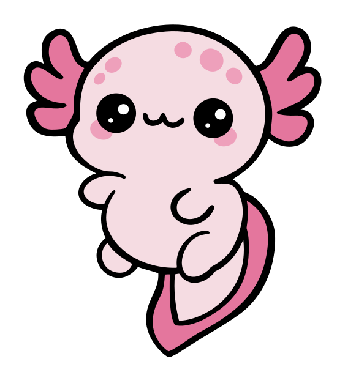

# The AX mascot

AX's mascot is an **[axolotl](https://animals.sandiegozoo.org/animals/axolotl)**, an aquatic salamander recognizable by the feathery external gills around its head. The three rounded branches on each side of the mascot are stylized gills. Its name is **axel**.

The name is a natural fit: **ax**olotl starts with **AX**. The round pink face, small smile, and blush cheeks represents the friendly nature of the project.

## Logo file

[axel.svg](../assets/axel.svg) is the mascot, used in the README and documentation. Preserve its proportions when resizing and leave room around the gills.
